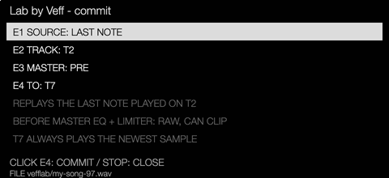
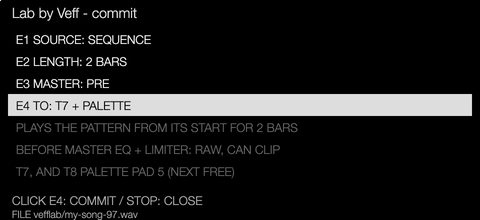
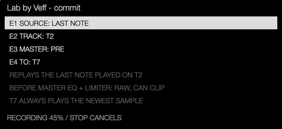

# Lab by Veff

Lab by Veff is built into the Veff fork's firmware, beside Linear by Veff. It
turns a project into a sound-design bench: make a sound on any track, commit it
as a sample with one gesture, and play or process it straight away.

## Turn it on

Project Settings > General > **lab mode**: On. The project keeps the setting in
its companion file (`song.xy.oxyl`), next to Linear's mode. Lab and Linear can
be on together.

## How the tracks work in Lab

| Track | Role |
| --- | --- |
| T1–T6 | Ordinary tracks. Build a sound and its sequence here, with MultiFX on the sends if you like. This is what you commit: one track's last note, or the whole pattern. |
| T7 | Temporary. A Sampler that always holds the newest commit; the next commit replaces it. Play it, sequence it, or commit it again to stack generations. |
| T8 | The palette. A Drum Sampler: with E4 set to T7 + palette, each commit also lands on its next free pad, left to right, 24 pads. |

When the palette is full, or simply good, save T8 as an instrument preset (the
OP-XY's own preset save) and load it on any track, in this project or another.
Then clear T8, or load an empty Drum Sampler, and start a fresh palette.

Make T7 a Sampler and T8 a Drum Sampler before the first commit.

## Commit a sound

1. Press **Stop + Sample**. On Linear's timeline Shift + Sample stays Linear's
   own bounce, so open the panel from any other page.
2. The panel shows one row per encoder, then why, then the file it will write:
   - **E1 source**: **last note** replays the last note played on a track;
     **sequence** plays the pattern from its start.
   - **E2**: the note's track, or the sequence's length: 1, 2, 4 or 8 bars.
   - **E3 master**: **pre** (default) records the mix before the master EQ and
     compressor/limiter; **post** records what you hear.
   - **E4 to**: **T7**, or **T7 + palette** to also fill T8's next free pad.
3. Click **E4** to commit. The page shows the progress; **Stop** cancels. When
   it is done, the panel closes with a popup of the outcome.

A last note is replayed held for one second at velocity 100 and recorded for
two more seconds for its tail. A sequence needs Linear off: it plays the native
pattern from its start, then stops. A commit is at most about 20 seconds.

## Files

Commits are saved in the User sample folder under `vefflab/`, named after the
project and a lineage: `song-99.wav`, then `song-98.wav`. A commit made by
playing a palette pad that holds one of Lab's samples extends that sample's
name: from the pad holding `song-98`, `song-98-99.wav`. The numbers count down
from 99, so the newest sorts first.

## Where it lives

| Part | Files |
| --- | --- |
| Panel and gestures | `sdk/platform/opxy-1.2.1/lab_ui.cpp`, drawn on Linear's page in `arranger_ui.cpp` |
| Panel text and file names | `sdk/platform/opxy-1.2.1/lab_model.hpp`, tested in `tests/fixtures/lab_model.cpp` |
| Commit: source, file, T7 and T8 | `sdk/platform/opxy-1.2.1/lab_commit.cpp` |
| Capture, writer checks | Linear's bounce coordinator, `arranger_bounce.cpp` (a Lab request) |
| Native playback for a sequence | `arranger_transport.cpp` (`sdk_lab_transport_*`) |
| Mode flag | `arranger_project.cpp`, companion flags bit 2 (`arranger_storage.hpp`) |

## Limits of this prototype

- Not yet tested on a device.
- The last note is replayed at velocity 100 and held one second, not as played.
- A sequence commit needs Linear off.
- T7 must already be a Sampler and T8 a Drum Sampler.
