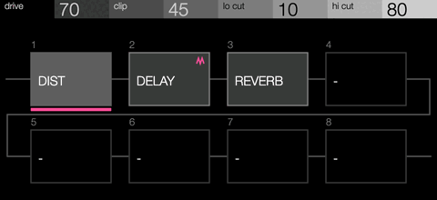
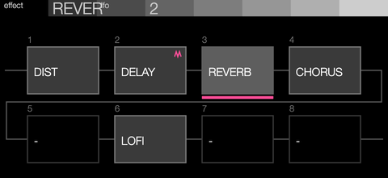

# MultiFX by Veff

MultiFX is built into the Veff fork's firmware, like Linear by Veff. It is a send
effect that runs a chain of up to eight effects in series on FX I or FX II.
Each send can hold its own chain.

## Use it

1. Choose **MultiFX** as the send's effect, as you would choose delay or reverb.
2. On the send page, press **Stop + 1–8** to pick the slot the encoders edit.
   A popup names the slot and its effect.
3. Turn **Shift + E1** to choose the slot's effect: none, stock's delay, reverb,
   chorus, phaser, dist and lofi, then every effect machine this firmware
   installed (Ring Mod, Ping Pong and any you chose on the installer site).
4. Turn **Shift + E2** to choose the slot the send's LFO moves. An LFO aimed at
   param 1–4 then moves that slot's four parameters.
5. Turn **E1–E4** to set the slot's parameters. The titles are the stock effect's
   own names for them. With a step held, the turns lock the step, as on any send.

A track's send amount and the send's mute work as they do for any send effect.

## Scramble and undo

Hold **Stop + Shift** on the send page for scramble's layer:

- Turn **E3** and **E4** to set the fewest and most effects a scramble puts in
  the chain, 1–8 (1–7 at first). The header shows both.
- Click **E4** to scramble: a random number of effects in that range fills
  slots 1 onwards, each a random installed effect with random parameters, and
  the send's LFO moves one of them. Slots after them are emptied. A scramble
  never picks more delays and reverbs than fit in the send's memory.
- Click **E3** to go back to the chain before the last scramble or effect
  change, up to 8 steps back. The history lasts until the OP–XY restarts.

Each send keeps its own range, saved with the project.

## Installed effects in a slot

An effect machine in a slot works as it does on a send of its own, with two
differences. E1–E4 set its first four controls; its other controls stay in the
middle of their range. And its memory comes from the send's 1 MiB like every
stage's, so two effects that each take a 512 KiB buffer fill a send. The
chain's CPU is the sum of its stages: several heavy effect machines on one send
can exceed the budget.

## How the chain sounds

The first stage processes the send's input and returns only its wet signal, as a
lone send effect does. Each later stage processes the chain so far, then adds its
input back at that stage's dry level. A reverb after a distortion therefore keeps
the distortion and adds its tail.

Each send has 1 MiB of memory for delay lines. Stock gives all of it to one
effect. MultiFX gives each stage its own part instead, so a delay, a reverb and a
chorus fit together on one send. Changing one slot's effect builds that slot
alone in free memory, so the other slots keep playing, tails and all. A stage
that does not fit stays silent until another slot frees memory.

## The page

MultiFX draws its own send page: the edited slot's parameters in the header,
then the chain as two rows of four blocks from the send's input to its output,
each named after its effect. The edited slot is lit and underlined, and the LFO
slot carries a mark.

## Where it lives

| Part | Files |
| --- | --- |
| Chain host (the send effect) | `veff/machines/veffmultifx` |
| Layout shared with the platform | `sdk/include/opxy/multifx.hpp` |
| Stock effect stages and the send memory allocators | `sdk/platform/opxy-1.2.1/multifx_stock.cpp`, profile hooks at `8d50e048` and `8d50dfc0` |
| Send page controls and gestures | `sdk/platform/opxy-1.2.1/multifx_ui.cpp`, wired in `synth_controls.cpp` and `module_events.cpp` |
| The installer's always-included card | `builder/veff.json` (`features`, `machine`) |

Slots 1–4 store their effect in send track word 47 and slots 5–8 in word 46,
one byte per slot (bit 7 stays clear, so slots 4 and 8 never make their word
negative); word 45 names the LFO's slot in its low byte and scramble's range
in bits 8–15. The slots' parameters use the
send words below 42 that stock leaves alone on a send: 0–15, 17, 18, 20–22,
28–35, 37–39 (`sdk/include/opxy/multifx.hpp`). Step locks reach them all.
A hook on the LFO's write (`8d50f412`) moves param 1–4 to the LFO slot's words.

## Limits

- The page has not been tested on a device yet.
